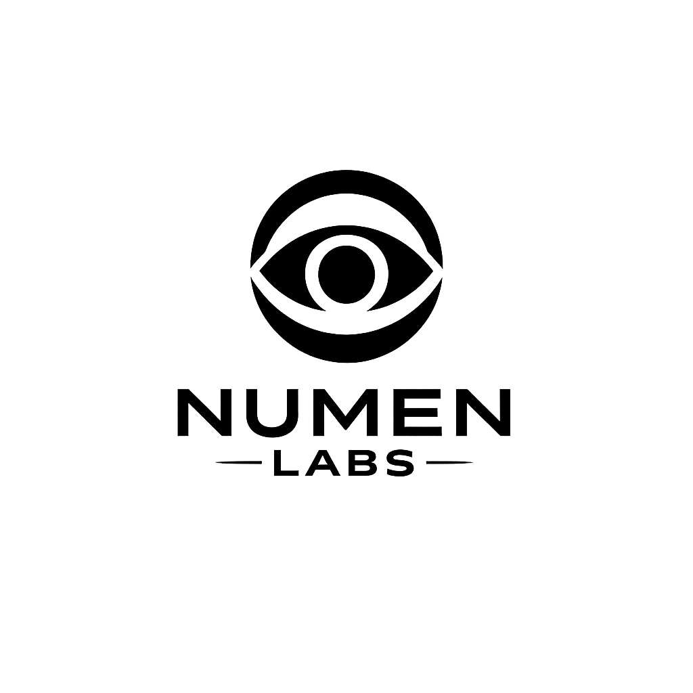

<p align="center">
  
</p>

# Antigravity Cowork for Brave — Background Tab Groups, Visual Indicator & MCP Server

**Developed by [NumenLabs](https://github.com/tokyodaito)**

Zero-dependency Brave extension + local MCP server that brings a full **Cowork browser experience** to **Antigravity CLI (`agy`)**:

- **Background Task Tab Groups (`chrome.tabGroups`)** — creates a named, colored, collapsed tab group per task session, opens all agent tabs in the background without stealing focus, and deletes the group cleanly when the task finishes.
- **Visual Agent Indicator, Flying Cursor & Instant Kill-Switch** — injects a subtle glowing border, a Claude-style animated flying cursor (`AGY`) with click ripple animations that tracks every agent click/hover/input, and a floating status pill with a **Stop** button onto agent-controlled tabs, plus a toolbar popup to inspect, focus, or close active task groups.
- **Native Messaging Bridge** — zero external npm dependencies, zero permission popups, communicates locally over a `0600` Unix domain socket (`/tmp/agy-brave-cowork.sock`).
- **Read-Only Context** — search Brave browsing history and bookmarks directly from the agent.

## Quick Start

Requires **Node.js 18+**, **Brave Browser**, and **Antigravity CLI (`agy`)**.

1. Clone and run the installer (Linux & macOS):

```bash
git clone https://github.com/tokyodaito/agy-brave-cowork.git
cd agy-brave-cowork
./install.sh
```

2. Load the unpacked extension in Brave:
   - Open `brave://extensions`
   - Enable **Developer mode**
   - Click **Load unpacked** and select `~/.local/share/agy-brave-cowork/extension`

3. *(Recommended)* Connect `chrome-devtools-mcp` to your live Brave profile for full DOM/click/fill/screenshot automation:

```bash
agy mcp add chrome-devtools npx -- -y chrome-devtools-mcp@latest \
  --autoConnect \
  --userDataDir="$HOME/.config/BraveSoftware/Brave-Browser"
```

   Then open `brave://inspect/#remote-debugging` and enable **Allow remote debugging for this browser instance**.

4. *(Optional)* Copy [GEMINI.example.md](./GEMINI.example.md) to `~/.gemini/config/GEMINI.md` so `agy` automatically creates collapsed background task folders, never steals focus, and cleans up after every browser task.

5. Restart `agy`.

## MCP Tools (`brave-cowork`)

| Tool | Description |
| --- | --- |
| `brave_create_task_group` | Create a named, colored (collapsed by default) tab group and open background tabs inside it |
| `brave_open_tab_in_group` | Open a new background tab inside an existing task group |
| `brave_list_task_groups` | List all Brave tab groups and their tabs (marking agent-owned sessions) |
| `brave_update_task_group` | Rename, recolor, collapse, or expand a tab group |
| `brave_close_task_group` | Close all tabs in a task group, deleting the group folder |
| `brave_close_all_task_groups` | Close and delete all active agent task groups |
| `brave_set_tab_indicator` | Show or hide the visual agent border and Stop pill on a tab |
| `brave_search_history` | Search Brave browsing history (read-only) |
| `brave_search_bookmarks` | Search Brave bookmarks (read-only) |

## Architecture

```text
agy (MCP client)
  └── stdio JSON-RPC ──▶ mcp-server.mjs
                            └── Unix socket (0600) ──▶ native-host.mjs
                                                          └── Chrome Native Messaging ──▶ Brave Extension (MV3)
```

## License

Proprietary — see [LICENSE](./LICENSE). Commercial use or reference requires 93% gross revenue share; charitable/non-profit use is strictly prohibited.
